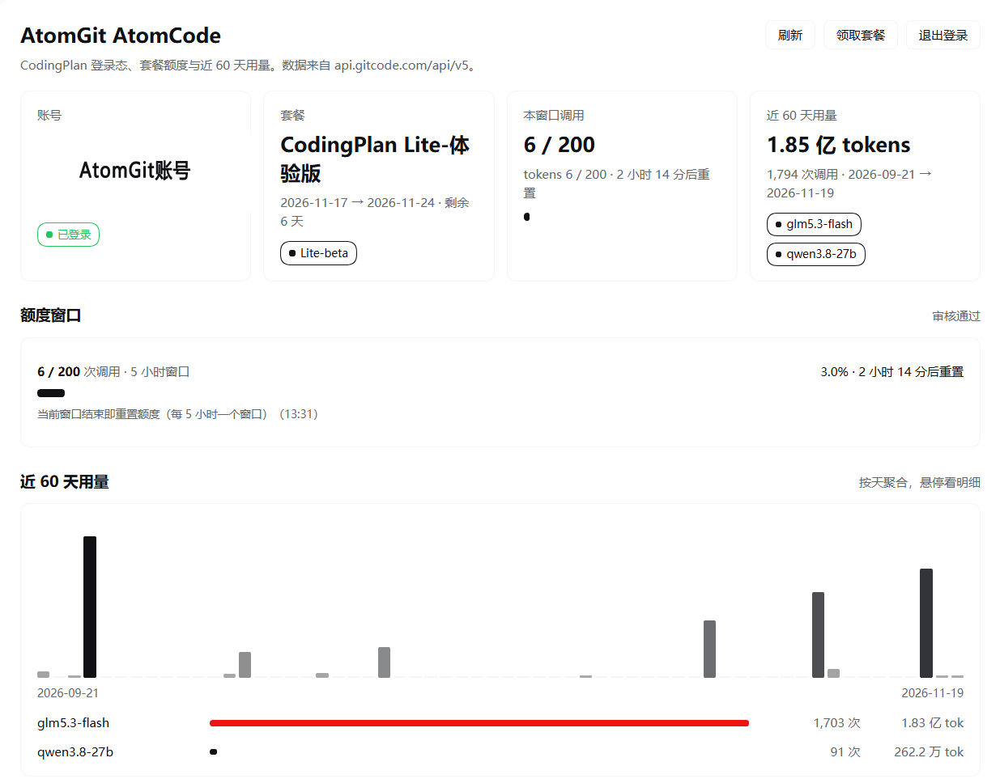

# dsh-atomcode

> **English** · [简体中文](README.md)

A [DeepSeek Harness](https://github.com/deepseek-ai) (DSH) plugin that connects the models in **AtomGit AtomCode CodingPlan** to the chat window — plus a sidebar panel for login state, quota and usage.

- Repository: <https://github.com/wellsoren/dsh-atomcode>
- How it works (signing, endpoints, troubleshooting): [Instructions.md](Instructions.md)

---

## Features

- **One provider**: `atomcode`. Models come from CodingPlan (`models-v2`) and only entries available to the current plan are registered. With the account used during development that is `qwen3.8-27b` (262k context / 32k output / vision / `low`·`medium`·`xhigh`) and `glm5.3-flash` (512k / 16k / vision / `low`·`high`).
- **Shared sign-in**: reads the AtomCode CLI's `~/.atomcode/auth.toml`. Without the CLI you can click **Sign in** in the panel and complete OAuth in the browser; the result is written back to the same file. Expiring tokens are refreshed with `refresh_token` and the rotated pair is persisted.
- **Signing proxy**: the AtomGit gateway requires `X-AtomCode-*` request signatures (HMAC over the raw body bytes), so the plugin runs a loopback proxy on `127.0.0.1` that signs and forwards. To DSH it is just another OpenAI-compatible endpoint.
- **Model refresh**: fetched at startup and hourly afterwards; if the service is unreachable the plugin falls back to a built-in seed list, so chat keeps working.
- **Per-model allowlist**: leave `enabledModels` empty to expose everything, or list the ids you want.
- **Sidebar panel**: login state, plan, 5-hour quota windows, 60-day daily/per-model usage — with refresh, claim, sign-in and sign-out actions.
- **Vision and reasoning levels**: `supports_vision` enables image input; `reasoning_effort_levels` maps straight onto DSH thinking levels, and undeclared levels are pinned as unsupported.

## Installation

Requires DSH ≥ `0.1.2-rc.1` and Node `^22.19.0 || >=24.0.0`. Plain JavaScript, no build step.

1. Get this repository (`git clone` or download a tarball);
2. In DSH, call `plugin_manager` with `install_bundle` and point `target` at the directory or tarball;
3. Enable `dsh-atomcode` on the Plugins page;
4. **Reload the page once** — the browser half is assembled at page boot; the host half needs no DSH restart.

Sign in either way:

```bash
atomcode login          # if the AtomCode CLI is installed, the plugin reuses its auth.toml
```

…or open the **AtomCode** panel and click **Sign in**, then authorize in the browser.

After editing `lib/*.js`, disable and re-enable the plugin on the Plugins page to hot-reload the host half.

## Sidebar panel

The **AtomCode** icon in the left rail opens:



| Section       | Contents                                                                                  |
| ------------- | ----------------------------------------------------------------------------------------- |
| Account       | Login state, `name · @username`, `auth.toml` path, token expiry                           |
| Plan          | `CodingPlan Lite-体验版` / Pro name, claimed → expiry dates, days left, tier                 |
| This window   | `calls_used / call_limit`, token usage, reset countdown for the rolling **5-hour** window |
| Quota windows | Every enabled entry in `rate_limit_windows`, including its reset hint                     |
| Last 60 days  | Daily bar chart (hover for calls/tokens) plus per-model share, call count and tokens      |
| Models        | Context window, output cap, vision support, reasoning levels                              |
| Actions       | Refresh / Claim plan / Sign in / Sign out                                                 |

Data is polled every 60 seconds and countdowns tick every 30 seconds. Requests only go to the loopback endpoints `/api/atomcode/*`.

## Known limitations

- Only `/chat/completions` is proxied; `/responses`, embeddings and rerank are not wired yet.
- Single account: one login state per DSH process, no account rotation.
- Read-only usage: numbers come from `status-v2` / `usage`; nothing is tallied locally.
- The signing salt includes the client version, so a major AtomCode release (new algorithm or path) requires bumping `clientVersion` or updating the signer.
- The `auth.toml` file is shared with the CLI: AtomGit rotates `refresh_token` on refresh, so whichever side writes last wins and the other may occasionally need to sign in again.
- The panel is a browser-side component: after the first install (or any `dsh.client` change) reload the page.

## Privacy

- **Credentials stay local**: `access_token` / `refresh_token` live only in `~/.atomcode/auth.toml`. The plugin keeps no second copy and sends nothing to third parties; outbound calls go only to `acs.atomgit.com`, `api.gitcode.com` and `llm-api.atomgit.com`.
- **Loopback proxy**: listens on `127.0.0.1` only, requires `Authorization: Bearer <per-process random secret>` and validates `Host`; `/api/atomcode/*` additionally rejects non-loopback callers.
- **No telemetry**: the plugin collects and reports nothing.
- **Clean repository**: no real tokens, user ids, e-mail addresses or absolute paths. Tests use fixtures, and the capture verifier takes credentials from environment variables. `.gitignore` excludes `auth.toml` and capture logs.

## Disclaimer

This is an **unofficial** third-party plugin, not affiliated with or endorsed by AtomGit, AtomCode or DeepSeek.

- It relies on the observable protocol behaviour of the AtomCode client (login, CodingPlan endpoints, request signing). That behaviour may change between releases, and the plugin may stop working after an upgrade.
- This plugin is intended for personal learning and research only. Do not use it for commercial resale or any scenarios beyond reasonable personal use. By using it, you assume all risks, including account restrictions, quota loss, service interruptions, and any other consequences. Please comply with the terms of service of AtomGit / AtomCode.
- The software is provided "as is", without warranty of any kind. The authors are not liable for any direct or indirect damage arising from its use.

## Acknowledgements

- **AtomCode / AtomGit** — the de-facto standard for login, CodingPlan and gateway behaviour comes from the official client.
- **[fyyhub/atm](https://github.com/fyyhub/atm)** — its public write-up of the signature scheme is where the `sign_v1` reconstruction started.
- **dsh-codearts** — the plugin layout (provider registration, loopback proxy, sidebar panel) follows its lead.
- **DeepSeek Harness / pi-ai** — the host and model adapter this plugin runs on.

## License

[MIT](LICENSE)
