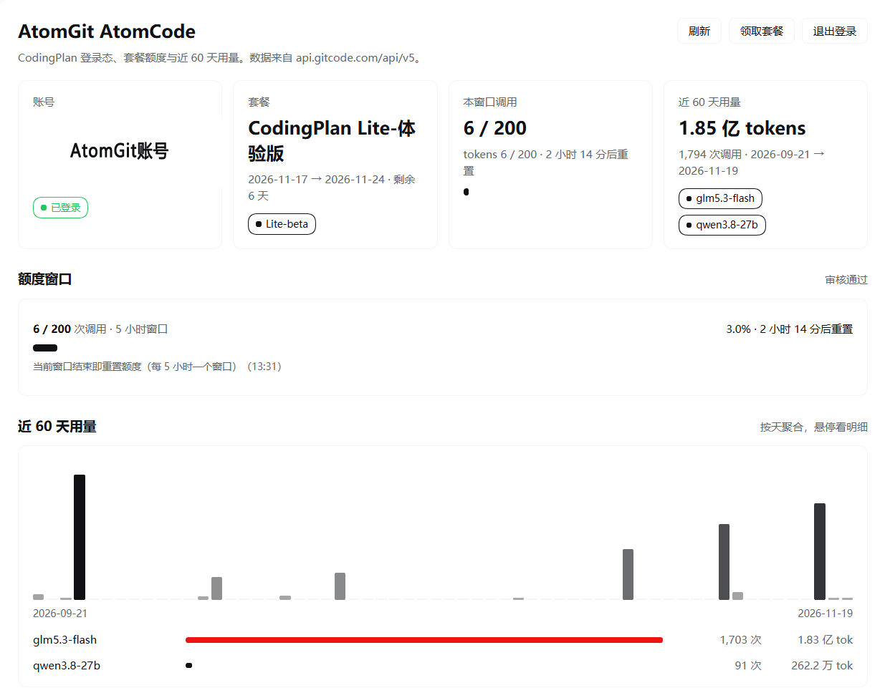

# dsh-atomcode

> [English](README.en.md) · **简体中文**

把 **AtomGit AtomCode CodingPlan** 里的模型接进 [DeepSeek Harness](https://github.com/deepseek-ai)（DSH）。

装好之后，模型选择器里多出一个 provider **AtomGit AtomCode**，聊天窗口照常用；左侧图标栏还会多一格 **AtomCode**，一眼看到登录状态、套餐额度和近 60 天用量。

- 仓库：<https://github.com/wellsoren/dsh-atomcode>
- 内部实现（签名算法、接口、排错）：[Instructions.md](Instructions.md)

---

## 功能简介

- **一个 provider**：`atomcode`，模型由 CodingPlan 服务端下发（`models-v2`），只注册当前套餐可用的条目。当前账号所见为 `qwen3.8-27b`（262k 上下文 / 32k 输出 / 视觉 / low·medium·xhigh）与 `glm5.3-flash`（512k / 16k / 视觉 / low·high）。
- **登录态复用**：直接读 AtomCode 官方 CLI 的 `~/.atomcode/auth.toml`；没装 CLI 也能在面板里点「登录」走一遍 OAuth，结果写回同一个文件。token 快过期时自动用 `refresh_token` 续期并轮换写回。
- **签名代理**：AtomGit 网关要求 `X-AtomCode-*` 请求签名（对 body 原始字节做 HMAC），插件起一个只监听 `127.0.0.1` 的回环代理完成签名与转发，对 DSH 来说它就是普通 OpenAI 兼容端点。
- **模型热更新**：启动时拉一次，之后每小时刷新；服务端不可用时回退到内置种子，聊天不受影响。
- **按模型开关**：`enabledModels` 留空是全开，填了就只暴露列出的模型。
- **侧边栏面板**：登录态、套餐、5 小时额度窗口、近 60 天按天/分模型用量，支持刷新、领取套餐、登录、退出。
- **多模态与推理档位**：服务端声明 `supports_vision` 的模型自动开图像输入；`reasoning_effort_levels` 原样映射到 DSH 的思考档位，没声明的档位显式钉成不支持。

## 安装

要求：DSH ≥ `0.1.2-rc.1`，Node `^22.19.0 || >=24.0.0`。纯 JS，无需构建。

1. 取到本仓库（`git clone` 或下载 tarball）；
2. 在 DSH 里用 `plugin_manager` 的 `install_bundle`，`target` 指向仓库目录或打包后的 tarball；
3. 在 Plugins 页启用 `dsh-atomcode`；
4. **刷新一次页面**（浏览器端在页面启动时组装；宿主端不需要重启 DSH）。

登录二选一：

```bash
atomcode login          # 已经装了 AtomCode CLI：插件直接复用它的 auth.toml
```

或者打开侧边栏 **AtomCode** 面板点「登录」，按提示在浏览器里授权。

改完 `lib/*.js` 后，在 Plugins 页把插件「禁用 → 启用」即可热重载宿主侧代码。

## 侧边栏面板

左侧图标栏的 **AtomCode** 打开后：



| 区块       | 内容                                                     |
| -------- | ------------------------------------------------------ |
| 账号       | 登录状态、`name · @username`、`auth.toml` 路径、token 到期        |
| 套餐       | `CodingPlan Lite-体验版` / Pro 名称、领取日 → 到期日、剩余天数、档位       |
| 本窗口      | `calls_used / call_limit`、tokens 用量、**5 小时**滚动窗口的重置倒计时 |
| 额度窗口     | `rate_limit_windows` 中启用的每一条，含重置说明                     |
| 近 60 天用量 | 按天柱状图（悬停看次数/tokens）+ 分模型占比、调用次数、tokens                 |
| 可用模型     | 上下文、输出上限、是否视觉、推理档位                                     |
| 操作       | 刷新 / 领取套餐 / 登录 / 退出登录                                  |

数据每 60 秒轮询一次，倒计时每 30 秒刷新；请求只发往本机回环接口 `/api/atomcode/*`。

## 已知限制

- 只代理 `/chat/completions`；`/responses`、embeddings、rerank 还没接。
- 单账号：一个 DSH 进程一套登录态，没有多账号轮换。
- 用量只读：数据来自 `status-v2` / `usage`，不在本地记账。
- 签名盐里包含客户端版本：AtomCode 换大版本（改签名算法或路径）时，需要同步 `clientVersion` 或更新签名实现。
- 与 CLI 共享 `auth.toml`：AtomGit 的 refresh 会轮换 `refresh_token`，两边以最后写入的为准，极端情况下另一侧需要重新登录。
- 面板是浏览器端组件，首次安装或改动 `dsh.client` 后要刷新页面才出现。

## 隐私

- **凭证不出本机**：`access_token` / `refresh_token` 只存在 `~/.atomcode/auth.toml`，插件不另存副本，也不发往任何第三方；所有出网请求只到 `acs.atomgit.com`、`api.gitcode.com`、`llm-api.atomgit.com`。
- **回环代理**：只监听 `127.0.0.1`，要求 `Authorization: Bearer <每进程随机口令>`，并校验 `Host`；`/api/atomcode/*` 额外校验来源必须是回环地址。
- **无遥测**：插件不收集、不上报任何使用数据。
- **仓库干净**：不含真实 token、用户 id、邮箱或绝对路径；测试用 fixture，抓包校验的凭证从环境变量读。`.gitignore` 已排除 `auth.toml` 与抓包日志。

## 免责声明

本项目是**非官方**的第三方插件，与 AtomGit、AtomCode、DeepSeek 均无隶属或背书关系。

- 它复用 AtomCode 客户端的公开协议行为（登录、CodingPlan 接口、请求签名）。这些行为可能随版本变化，升级后插件可能失效。
- 本插件仅供个人学习研究，请勿用于商业转售或任何超出个人合理使用的场景。使用即表示你自行承担账号被限制、额度损失、服务中断等一切后果；请遵守 AtomGit / AtomCode 的服务条款。
- 插件按「现状」提供，不附带任何明示或暗示的担保；因使用本软件造成的任何直接或间接损失，作者不承担责任。

## 致谢

- **AtomCode / AtomGit**：登录、CodingPlan 与网关协议的事实标准来自官方客户端的行为。
- **[fyyhub/atm](https://github.com/fyyhub/atm)**：公开的签名算法说明，是本项目还原 `sign_v1` 的起点。
- **dsh-codearts**：插件结构（provider 注册、回环代理、侧边栏面板）参考了它的做法。
- **DeepSeek Harness / pi-ai**：插件运行其上的宿主与模型适配层。

## 许可证

[MIT](LICENSE)
